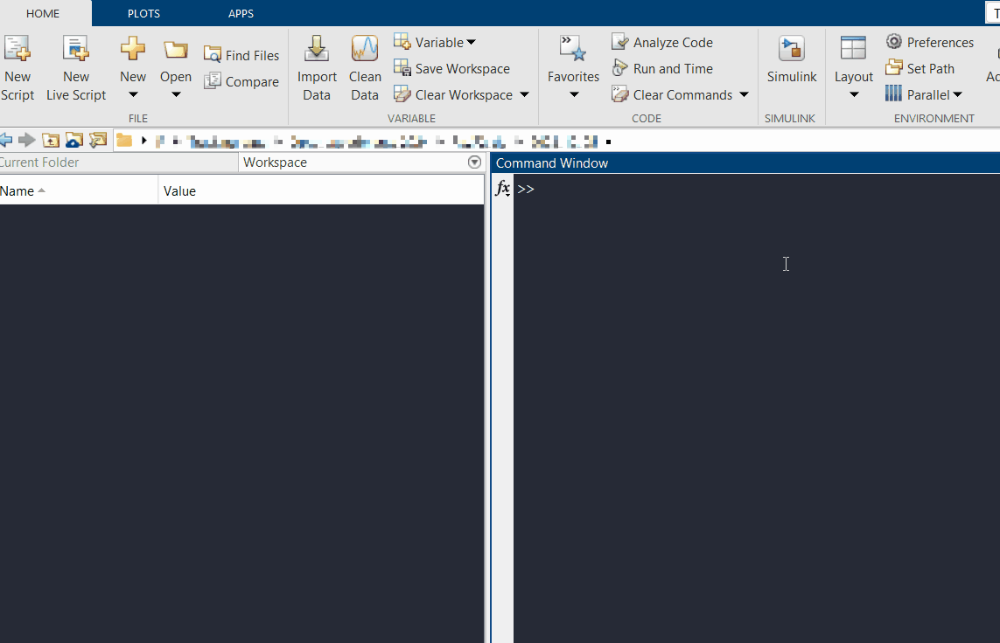

# Installation and system requirements

#### System Requirements <a id="requirement"></a>
CaliAli runs in `MATLAB` and requires:
```
-	Signal Processing Toolbox
-	Image Processing Toolbox
-	Statistics and Machine Learning Toolbox
-	Parallel Computing Toolbox
```

!!! note "MATLAB R2026b and later: Java"
    From R2026b, MATLAB no longer includes Java, and CaliAli's file picker needs it. The first time it is needed, CaliAli downloads a Java runtime (Eclipse Temurin 21, about 50 MB), sets MATLAB to use it, and asks you to restart MATLAB once. To install Java yourself, see [Machines without internet](#offline).
		
#### System Compatibility and Supported Formats <a id="supported-formats"></a><a id="compatibility"></a>

??? Question "Platform and format compatibility"
	CaliAli supports `.avi / .m4v / .mp4 / .tif / .tiff / .h5 / .isxd (Inscopix)`, but requirements differ by operating system:

	!!! warning "Version 1.5.0 not yet tested on older MATLAB versions"
		The tests listed below were made with earlier versions of CaliAli. Version 1.5.0 has so far been tested only on MATLAB 2024b on Ubuntu. It has not yet been tested on MATLAB 2022a, the oldest version CaliAli has been tested on, or on Windows or macOS.
		
	=== "Windows"
		CaliAli has been successfully tested on MATLAB versions 2022a and 2023a running on Windows 11.
		MATLAB cannot read many `.avi` files on Windows by itself. CaliAli reads those with FFmpeg (see [Videos MATLAB cannot read](#ffmpeg)), so the K-Lite Codec Pack is no longer needed.
		
		!!! bug "MATLAB 2024a Not Supported"
    		Due to an AppDesigner bug in MATLAB 2024a, GUI elements may be misplaced and some functions may not work properly. This issue does not occur in Windows MATLAB 2023b or on other operating systems.

		!!! bug "Requires MATLAB 2023b"
    		The [BV_app utility](Functions_doc/BV_app.md#BV_app) requires MATLAB 2023b due to its use of newer AppDesigner functions. This utility is optional and not required to run the CaliAli pipeline.

		!!! warning "Inscopix Users"
    		The Inscopix Data Processing software must be installed. By default, CaliAli searches in:
    		`C:\Program Files\Inscopix\Data Processing`
    		If not found, you will be prompted to manually select the folder.

	
	=== "Mac"
		CaliAli has been successfully tested on MATLAB 2024a running on macOS Sonoma 14.5.
		- CaliAli cannot convert Inscopix `.isxd` data on ARM machines. Use Inscopix software to export to `.h5`, uncompressed `.avi`, or `.mp4` before running CaliAli.

	=== "Linux"
		CaliAli has been tested on Ubuntu 25.10 (Questing Quokka) and worked without problems.
		- CaliAli cannot convert Inscopix `.isxd` data directly on Linux. Use Inscopix software to export to `.h5`, uncompressed `.avi`, or `.mp4` before running CaliAli.

#### Videos MATLAB cannot read <a id="ffmpeg"></a>
Which videos MATLAB's `VideoReader` can read depends on the computer. A Mac, for example, cannot read GREY or FFV1 `.avi` files, the formats the Miniscope software writes. When `VideoReader` fails, CaliAli reads the video with [FFmpeg](https://ffmpeg.org) instead:

- If FFmpeg is installed on the computer, CaliAli uses it.
- If not, CaliAli downloads it the first time it is needed (FFmpeg 6.1.1, 20 to 30 MB) and prints a green message while it does.

Downloads are checked against a fixed checksum and kept in a folder of your own, not in the CaliAli folder:

| System | Folder |
|--------|--------|
| Windows | `%LOCALAPPDATA%\CaliAli` |
| macOS | `~/Library/Application Support/CaliAli` |
| Linux | `~/.local/share/CaliAli` |

#### Machines without internet <a id="offline"></a>
- **FFmpeg:** install it so that `ffmpeg` runs in a terminal (for example `brew install ffmpeg` on a Mac or `sudo apt install ffmpeg` on Ubuntu) and restart MATLAB. Alternatively, copy an `ffmpeg` program to the computer and run `setpref('CaliAli', 'ffmpeg', '/path/to/ffmpeg')`.
- **Java (MATLAB R2026b and later):** install **MATLAB Support for OpenJDK** from the Add-On Explorer and run `jenv -clear`, or install an OpenJDK from [Adoptium](https://adoptium.net) and run `jenv("system")`. Restart MATLAB; `version -java` shows whether MATLAB found it. See [MathWorks' instructions](https://www.mathworks.com/help/matlab/matlab_external/configure-your-system-to-use-java.html).

### Hardware <a id="hardware"></a>

CaliAli automatically runs in batch mode. You mainly need enough RAM for your largest session and enough storage for outputs.

#### Installation <a id="installation"></a>
Installation should take a few minutes:

-	Download/clone the [Git](https://github.com/CaliAli-PV/CaliAli) repository of the codes
-	Add the entire CaliAli repository to the MATLAB path 



=== "Next"
Already installed? Proceed to [CaliAli processing steps](Getting_started.md#ps)
